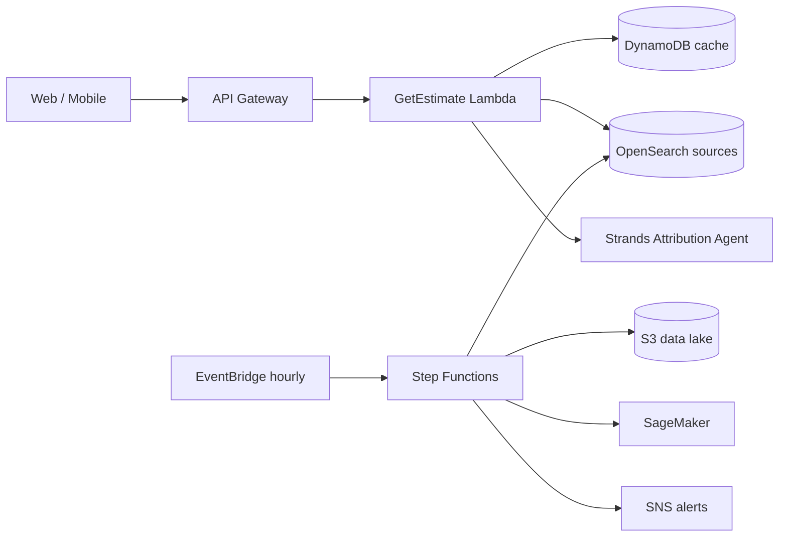

# Dhuan Detective

**Street-level air quality attribution for Delhi.** *"Why is the air bad on my street right now, and what should I do about it?"*

Delhi reports official PM2.5 from a few dozen CPCB stations for ~20 million people, but pollution changes sharply from street to street. Dhuan Detective estimates PM2.5 at any coordinate **with an honest uncertainty range**, finds the pollution sources upwind of you, and uses an AWS **Strands Agent** to explain the likely cause in plain Hindi or English — plus personalized advice for parents, delivery riders, and outdoor workers.

This is not another AQI number app. It answers the *why* and the *so what*.

> **Competition:** WeMakeDevs AWS Hackathon · Air track · Deadline Sunday, Oct 11.

---

## Why this wins
- **Live & real** — Delhi's air is bad right now; judges can verify estimates against the real world.
- **A validation number** — Leave-One-Station-Out (LOSO) error is reported openly. Almost no team does this.
- **Source attribution with visible reasoning** — the agent shows its tool calls, so the AI is checkable, not a black box.
- **Specific users** — children at school, riders on the road, outdoor workers.
- **AWS-native architecture** — Strands, OpenSearch, Step Functions, EventBridge, SNS, Lambda, DynamoDB, S3, Amazon Location, Cognito, SageMaker.

## Architecture at a glance
See [`docs/ARCHITECTURE.md`](docs/ARCHITECTURE.md) for full C4 diagrams, sequence flows, and the Step Functions state machine.



## Quick start (local, no AWS account required)
```bash
git clone https://github.com/Creativesoul0001/air-pollution-.git
cd air-pollution-
cp .env.example .env
make dev        # starts OpenSearch, LocalStack, PostGIS, Redis, backend, frontend
```
- Frontend: http://localhost:3000
- API docs: http://localhost:8000/docs
- OpenSearch: http://localhost:9200

See [`docs/DEPLOYMENT.md`](docs/DEPLOYMENT.md) for local and production (`sam deploy`) runbooks.

## Repository map
```
backend/   FastAPI + Lambda (Python) — API, agents, pipeline, services
frontend/  Next.js 14 + TypeScript — single-screen responsive UI
ml/        XGBoost PM2.5 model, LOSO validation, SageMaker packaging
infra/     AWS SAM template, Cedar policies, state machine definitions
docs/      Architecture, API, data model, agent + ML design, runbook
```

## Documentation
| Doc | Contents |
|-----|----------|
| [`docs/ARCHITECTURE.md`](docs/ARCHITECTURE.md) | System design, C4, request lifecycle, pipeline (Mermaid) |
| [`docs/DATA_MODEL.md`](docs/DATA_MODEL.md) | DynamoDB tables, OpenSearch index, S3 layout (Mermaid ERD) |
| [`docs/API.md`](docs/API.md) | REST + WebSocket API, request lifecycle |
| [`docs/AGENT_DESIGN.md`](docs/AGENT_DESIGN.md) | Strands agent loop, tools, trace format |
| [`docs/ML_MODEL.md`](docs/ML_MODEL.md) | Features, LOSO validation, serving |
| [`docs/DEPLOYMENT.md`](docs/DEPLOYMENT.md) | Local + AWS deploy, CI/CD |
| [`AGENTS.md`](AGENTS.md) | Rules for AI agents working in this repo |
| [`SKILL.md`](SKILL.md) | Reusable skill definition |

## Build order & the non-negotiables
Read [`MASTER_PROMPT.md`](MASTER_PROMPT.md) — the full engineering brief. Key rules:
- No fake routes. Every route validates, logs, and handles errors.
- Every estimate shows an uncertainty range.
- Attribution language is always "likely," never "confirmed."
- One feature working end-to-end beats five half-built ones.

## License
[MIT](LICENSE)
