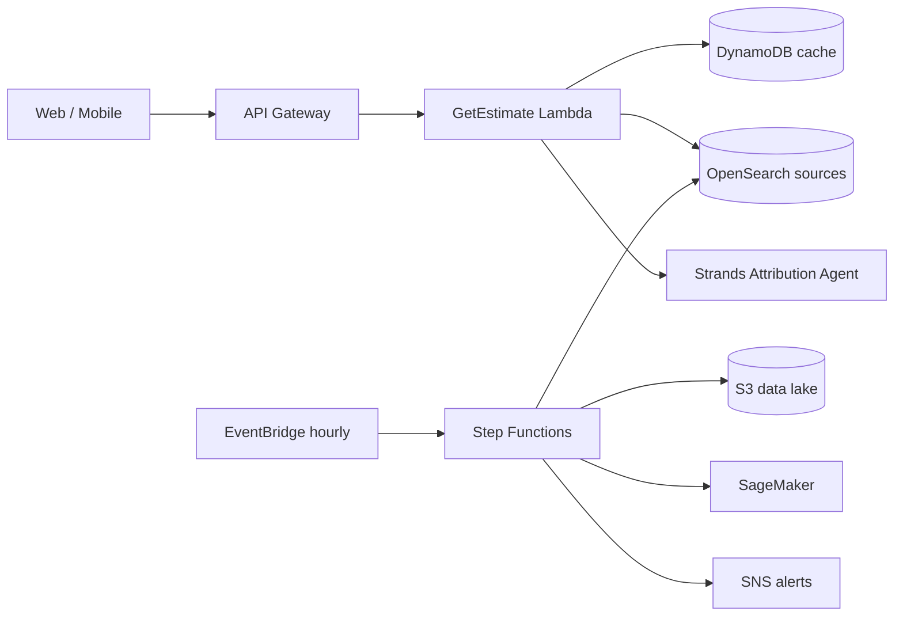

# Dhuan Detective

**Street-level air quality attribution for Delhi.** *"Why is the air bad on my street right now, and what should I do about it?"*

Delhi reports official PM2.5 from a few dozen CPCB stations for ~20 million people, but pollution changes sharply from street to street. Dhuan Detective estimates PM2.5 at any coordinate **with an honest uncertainty range**, finds the pollution sources upwind of you, and uses an AWS **Strands Agent** to explain the likely cause in plain Hindi or English — plus personalized advice for parents, delivery riders, and outdoor workers.

This is not another AQI number app. It answers the *why* and the *so what*.

> **Competition:** WeMakeDevs AWS Hackathon · Air track · Deadline Sunday, Oct 11.

---

## Why this wins
- **Live & real** — Delhi's air is bad right now; judges can verify estimates against the real world.
- **A validation number** — Leave-One-Station-Out (LOSO) error is reported openly. Almost no team does this.
- **Source attribution with visible reasoning** — the agent shows its tool calls, so the AI is checkable, not a black box.
- **Specific users** — children at school, riders on the road, outdoor workers.
- **AWS-native architecture** — Strands, OpenSearch, Step Functions, EventBridge, SNS, Lambda, DynamoDB, S3, Amazon Location, Cognito, SageMaker.

## Architecture at a glance
See [`docs/ARCHITECTURE.md`](docs/ARCHITECTURE.md) for full C4 diagrams, sequence flows, and the Step Functions state machine.



## Quick start (local, no AWS account required)
```bash
git clone https://github.com/Creativesoul0001/air-pollution-.git
cd air-pollution-
cp .env.example .env
make dev        # starts OpenSearch, LocalStack, PostGIS, Redis, backend, frontend
```
- Frontend: http://localhost:3000
- API docs: http://localhost:8000/docs
- OpenSearch: http://localhost:9200

See [`docs/DEPLOYMENT.md`](docs/DEPLOYMENT.md) for local and production (`sam deploy`) runbooks.

## Repository map
```
backend/   FastAPI + Lambda (Python) — API, agents, pipeline, services
frontend/  Next.js 14 + TypeScript — single-screen responsive UI
ml/        XGBoost PM2.5 model, LOSO validation, SageMaker packaging
infra/     AWS SAM template, Cedar policies, state machine definitions
docs/      Architecture, API, data model, agent + ML design, runbook
```

## Documentation
| Doc | Contents |
|-----|----------|
| [`docs/ARCHITECTURE.md`](docs/ARCHITECTURE.md) | System design, C4, request lifecycle, pipeline (Mermaid) |
| [`docs/DATA_MODEL.md`](docs/DATA_MODEL.md) | DynamoDB tables, OpenSearch index, S3 layout (Mermaid ERD) |
| [`docs/API.md`](docs/API.md) | REST + WebSocket API, request lifecycle |
| [`docs/AGENT_DESIGN.md`](docs/AGENT_DESIGN.md) | Strands agent loop, tools, trace format |
| [`docs/ML_MODEL.md`](docs/ML_MODEL.md) | Features, LOSO validation, serving |
| [`docs/DEPLOYMENT.md`](docs/DEPLOYMENT.md) | Local + AWS deploy, CI/CD |
| [`AGENTS.md`](AGENTS.md) | Rules for AI agents working in this repo |
| [`SKILL.md`](SKILL.md) | Reusable skill definition |

## Local run — backend + real Delhi NCR dataset

The backend ingests a **real, deduplicated** Delhi NCR location index from **OpenStreetMap** (Overpass, ODbL) and attaches **real PM2.5 readings** from **Open-Meteo** (keyless, batched). On first import we recorded **19,544 unique locations** (hospitals, major roads, parks, schools, metro stations, colleges, neighbourhoods, junctions, landmarks, cities) with **300 live pollution observations**. Counts are always read from the database — never hardcoded — and vary with each run.

```bash
# 1) Backend deps (Python 3.11+)
cd backend
python -m venv .venv
.venv/Scripts/activate            # Windows
pip install -r requirements.txt

# 2) Ingest real locations + observations (repeatable & deduplicated)
python -m app.pipeline.run         # prints real counts; safe to re-run

# 3) Run the API (defaults to sqlite:///./data/dhuan.db)
uvicorn app.main:app --port 8000   # health: /api/v1/health

# 4) Frontend proxies /api/* to API_UPSTREAM (default http://127.0.0.1:8000)
cd ../frontend && npm run dev      # http://localhost:3000
```

**Endpoints**
- `GET /api/v1/locations/stats` — totals, with-observations, cities, categories, last update
- `GET /api/v1/locations/search?q=` — real name search over the index
- `GET /api/v1/health`

**Tests:** `cd backend && pytest` (11) · `cd frontend && npm run test:unit` (8)

**Data integrity:** geographic coverage (indexed points) is reported separately from environmental coverage (points with a real reading). Model-based estimates report `0` until an ML model is deployed; the street-level estimate/attribution model is not deployed yet, so the UI shows a clearly-labelled development fixture for that panel only.

## Dashboard & data endpoints

The frontend is a premium dark air-quality intelligence dashboard (navy/teal) with **Map · Investigate · Analytics · Data Sources · About** views. The map uses keyless **OpenStreetMap** tiles darkened via raster paint (no API key, no watermark, correct attribution), with layers for real PM2.5 observation points and mapped POIs, a wind overlay, fullscreen, scale bar and a CPCB-band legend.

New real endpoints (`backend`):
- `GET /api/v1/airquality/current?lat&lon` — live PM2.5 / PM10 / NO₂ / SO₂ / O₃ / CO from Open-Meteo (model assimilation — **not** a ground station).
- `GET /api/v1/weather/current?lat&lon` — wind speed/direction, temperature, humidity (Open-Meteo).
- `GET /api/v1/locations/points?categories=` — capped POI points for map layers.
- `GET /api/v1/locations/observations/points` — latest stored PM2.5 observation per location.
- `GET /api/v1/locations/{id}` — location detail + latest observation.

AQI shown is the **CPCB PM2.5 sub-index** computed from PM2.5 with documented breakpoints. Every reading carries a data-status label — **Live observation / Cached observation / Model estimate / Development fixture / Unavailable**. Evidence-based source investigation and persistent action tracking are implemented; a validated spatial risk map is not, and is shown as *unavailable* rather than fabricated.

## Investigation, ground stations and action tracking

Additional real endpoints:

- `GET /api/v1/investigate?lat&lon` — evidence-based ranked hypotheses: combines **real wind** (Open-Meteo), **mapped sources** (OpenStreetMap/Overpass), ground readings where reachable, and the model air-quality estimate for context. Each hypothesis lists distance, bearing, upwind alignment, supporting evidence, contradicting evidence and uncertainty. Association only — never causation.
- `GET /api/v1/stations?lat&lon` — real ground monitoring readings. Returns `unavailable` with explicit reasons when no station feed is reachable (see [`PROGRESS.md`](PROGRESS.md) for verified access findings). Model estimates are **never** returned here.
- `POST/GET /api/v1/actions`, `POST /api/v1/actions/{id}/transition|assign|verify` — persistent action records with an authorized transition graph (illegal transitions → `422` with the allowed list), append-only audit history, and before/after verification that computes a delta **only** when both measurements have provenance (otherwise `insufficient_evidence`).

### Enabling real ground-station data
CPCB portals are unreachable and Sensor.Community has no Indian sensors, so `WAQI_TOKEN` (free from aqicn.org/data) is the supported path. Without it, the stations endpoint and UI report *unavailable* — no values are invented:

```bash
export WAQI_TOKEN=your-token
```

### Validated PM2.5 model

A real PM2.5 model is trained on **36,600 hourly observations** (25 NCR sample locations × 60 days) from Open-Meteo archives, and validated with **leave-one-location-out (LOSO)**:

| Candidate | LOSO RMSE (µg/m³) | LOSO R² | Verdict |
|---|---|---|---|
| Ridge regression (26 features, log-PM2.5) | 67.4 | −3.65 | rejected (worse than a mean baseline) |
| **IDW interpolation between real observations** | **10.9** | **+0.878** | **selected & served** |

Both candidates are always reported via `GET /api/v1/model/metrics` along with the selection note.

```bash
cd backend
python -m app.ml.train --days 60 --grid-step 0.15   # fetch real data, train, validate, persist
uvicorn app.main:app --port 8000
```

- `GET /api/v1/model/estimate?lat&lon` — `p10/p50/p90` with provenance and validation error
- `GET /api/v1/model/grid?resolution=0.05` — interpolated risk surface (default is *finer*
  than the training grid so cells are genuinely interpolated; out-of-radius cells are omitted)
- `GET /api/v1/model/coverage` — unique `(lat, lon)` sample locations covered
- Every response is tagged `is_model_estimate: true`; the uncertainty band is an empirical
  LOSO residual-quantile band, not a full predictive posterior.

### Map
The map uses **light OpenStreetMap tiles** with attribution (boundaries, city labels, roads, parks, water stay distinguishable). The previous dark overlay was removed. Tiles remain keyless; a vector/tile-API style (MapTiler/Carto/Google) would need a key and is not used.

See [`PROGRESS.md`](PROGRESS.md) for the full implementation checklist, verified live results, and what still needs credentials.


```bash
cd backend && uvicorn app.main:app --port 8000
cd frontend && npm run build && npm run start   # or: npm run dev
# frontend proxies /api/* to API_UPSTREAM (default http://127.0.0.1:8000)
```

## Build order & the non-negotiables
Read [`MASTER_PROMPT.md`](MASTER_PROMPT.md) — the full engineering brief. Key rules:
- No fake routes. Every route validates, logs, and handles errors.
- Every estimate shows an uncertainty range.
- Attribution language is always "likely," never "confirmed."
- One feature working end-to-end beats five half-built ones.

## License
[MIT](LICENSE)
