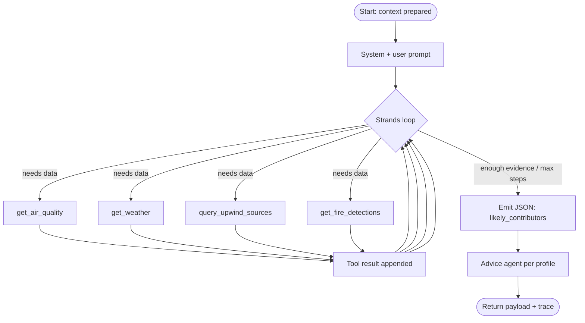

# Agent Design — Attribution & Advice

Two Strands Agents back the explanation and the advice. They are implemented with the open-source [Strands Agents SDK](https://strandsagents.com).

- **Attribution agent** (`backend/app/agents/attribution_agent.py`) — reasons over data, ranks *likely* contributors, and returns a structured payload.
- **Advice agent** (`backend/app/agents/advice_agent.py`) — turns the attribution summary into plain-language guidance per profile.

Both return the **actual** tool-call trace, which is surfaced in the UI. There is no hardcoded narrative.

## 1. Reasoning loop



Max steps: 8 (`STRANDS_MAX_STEPS`). Exceeding it returns a graceful partial result, never a hang.

## 2. Tools (`backend/app/agents/tools.py`)

| Tool | Purpose | Backing |
|------|---------|---------|
| `get_air_quality(lat, lon)` | Nearest station reading + current estimate | DynamoDB / OpenAQ |
| `get_weather(lat, lon)` | Wind vector, boundary-layer height | Open-Meteo |
| `query_upwind_sources(lat, lon, bearing, radius_km=5)` | Sources inside the upwind cone | OpenSearch |
| `get_fire_detections(lat, lon, hours=3)` | FIRMS thermal detections | S3 / FIRMS API |

Each tool is a pure function with typed I/O and its own unit test. In CI the tool boundary is mocked so no network calls occur.

## 3. Output contract

The attribution agent must emit:
```json
{
  "likely_contributors": [
    { "type": "landfill", "name": "Ghazipur", "distance_km": 9.4, "bearing_deg": 305, "confidence": "medium" }
  ],
  "summary": "Wind from the NW; a landfill and a construction cluster sit upwind within 5 km.",
  "confidence_overall": "medium"
}
```

**Language rules:** always "likely contributor" with a confidence (`low`/`medium`/`high`). The words "confirmed" and "caused by" are forbidden in user-facing strings and are asserted in tests.

## 4. Truthfulness & limits
- Attribution is an **inference** over upwind proximity, not proof. The UI states this.
- The source database is incomplete (OSM misses many construction sites). Treat it as improvable and surface `confidence: low` when few sources are found.
- If the agent fails or times out, the API returns estimate-only with `attribution_available: false`.

## 5. Trace format (persisted to `AgentTraces`, shown in UI)
```json
[
  { "step": 1, "tool": "get_weather", "input": { "lat": 28.63, "lon": 77.21 }, "result": "8 km/h NW, BLH 480 m" },
  { "step": 2, "tool": "query_upwind_sources", "input": { "bearing_deg": 305 }, "result": "3 sources" }
]
```

## 6. Advice profiles
- **Parent** — school-run timing, windows, exposure for children.
- **Rider** — directional exposure, cleanest-passing advice by hour.
- **Worker** — mask/shade/rest cadence.

The advice agent only rephrases attribution output; it does not introduce new causes.
