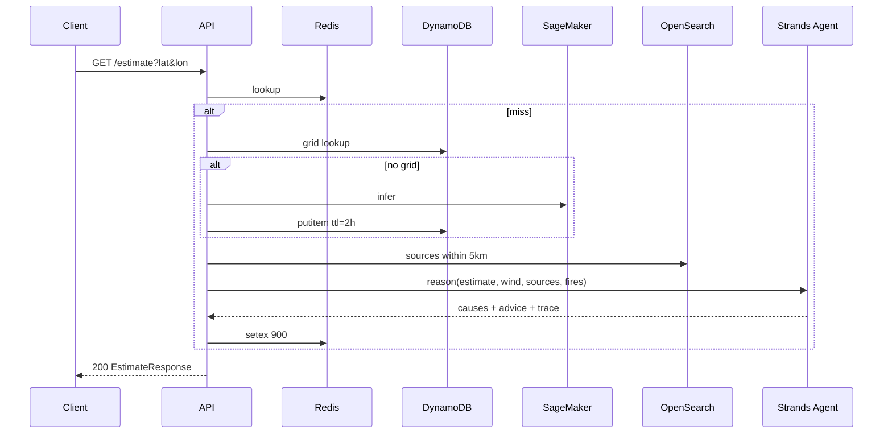

# API — Dhuan Detective

Base path: `/api/v1`. All payloads are JSON. Errors follow RFC 9457 problem+json.

## Conventions
- Auth: `Authorization: Bearer <Cognito JWT>` for protected routes; `/estimate` and `/health` are public.
- Validation failure → `422` with a field-level list.
- Dependency failure (OpenSearch / SageMaker down) → `503` with a `Retry-After` header.
- Every estimate response carries `pm25_p10/p50/p90`. A bare point estimate is never returned.

## 1. `GET /estimate`
Estimate street-level PM2.5 and attribute likely causes.

**Query**
| Param | Type | Required | Default | Notes |
|-------|------|----------|---------|-------|
| `lat` | number | yes | | Decimal degrees |
| `lon` | number | yes | | Decimal degrees |
| `lang` | `en`\|`hi` | no | `en` | Language for advice |
| `profile` | `parent`\|`rider`\|`worker`\|`generic` | no | `generic` | Primary advice card |

**Sequence**


**200 Example**
```json
{
  "location": { "lat": 28.6315, "lon": 77.2167 },
  "pm25_p50": 198.6,
  "pm25_p10": 171.2,
  "pm25_p90": 231.4,
  "aqi_category": "very_poor",
  "nearest_station": { "name": "Connaught Place", "distance_km": 0.8, "pm25": 205 },
  "attribution": {
    "attribution_available": true,
    "likely_contributors": [
      { "type": "landfill", "name": "Ghazipur", "distance_km": 9.4, "bearing_deg": 305, "confidence": "medium" },
      { "type": "construction", "name": "Central Vista", "distance_km": 1.2, "bearing_deg": 210, "confidence": "low" }
    ]
  },
  "advice": {
    "parent": "Keep windows closed until ~6 PM; prefer the covered metro walk.",
    "rider": "Wind NW 8 km/h — exposure lowest on southbound lanes this hour.",
    "worker": "Wear an N95 and take a 10-minute shaded break each hour."
  },
  "agent_trace": [
    { "step": 1, "tool": "get_weather", "result": "8 km/h NW, BLH 480 m" },
    { "step": 2, "tool": "query_upwind_sources", "result": "3 sources in 5 km cone" },
    { "step": 3, "tool": "get_fire_detections", "result": "0 detections in 30 km" }
  ],
  "generated_at": "2026-10-07T18:05:12Z"
}
```

**Failure**
- `422` — `lat` out of range.
- `503` + `Retry-After: 60` — OpenSearch/SageMaker unavailable. Body is estimate-only with `attribution.attribution_available: false`; causes are never fabricated.

## 2. `GET /sources/nearby`
`GET /sources/nearby?lat=&lon=&radius_km=5` — geospatial search over `pollution_sources`.

**200**
```json
{ "count": 4, "sources": [ { "type": "landfill", "name": "Ghazipur", "distance_km": 9.4, "bearing_deg": 305 } ] }
```

## 3. `POST /subscribe` (auth)
Body: `{ "channel": "email", "endpoint": "a@b.com", "lat": 28.63, "lon": 77.21, "radius_m": 2000, "threshold_pm25": 200, "frequency": "on_breach" }`
→ `201` `{ "subscription_id": "sub_01H..." }`. Validation: `radius_m` 250–5000; `threshold_pm25` 30–500.

## 4. `POST /report` (auth, multipart)
`photo` (jpg/png ≤ 8 MB), plus `lat`, `lon`, `category` (`construction_dust|waste_burning|dg_set|other`). Photo is blurred server-side (faces/plates), stored in a private bucket, and served only via short-lived pre-signed URLs.
→ `202` `{ "report_id": "rep_01H...", "status": "submitted" }`. `422` if image is missing/oversized.

## 5. `GET /health`
Checks OpenSearch, DynamoDB, SageMaker endpoint, and cache.
→ `200` `{ "status": "ok", "checks": { ... } }` or `503` `{ "status": "degraded", "checks": { ... } }`.

## 6. WebSocket `/ws`
`wss://…/ws?lat=&lon=` — pushes `weather.update` and `fire.detected` events for the subscribed ~10 km area.
