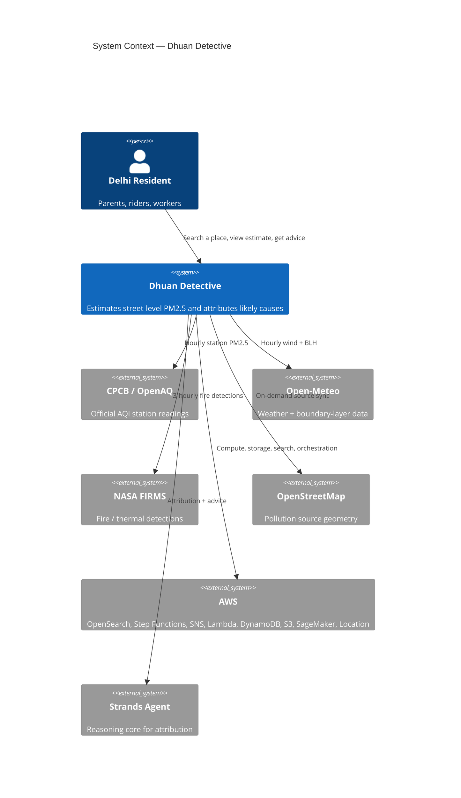
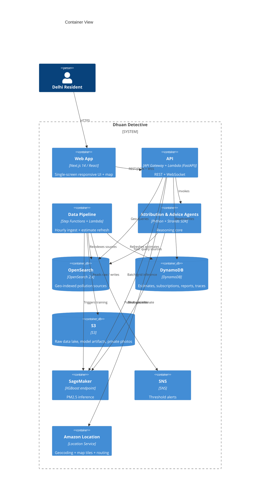
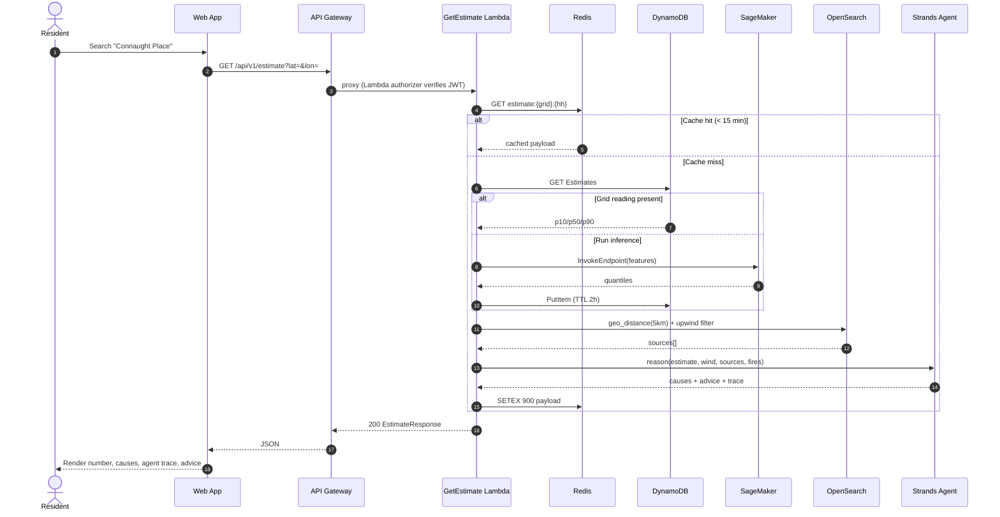
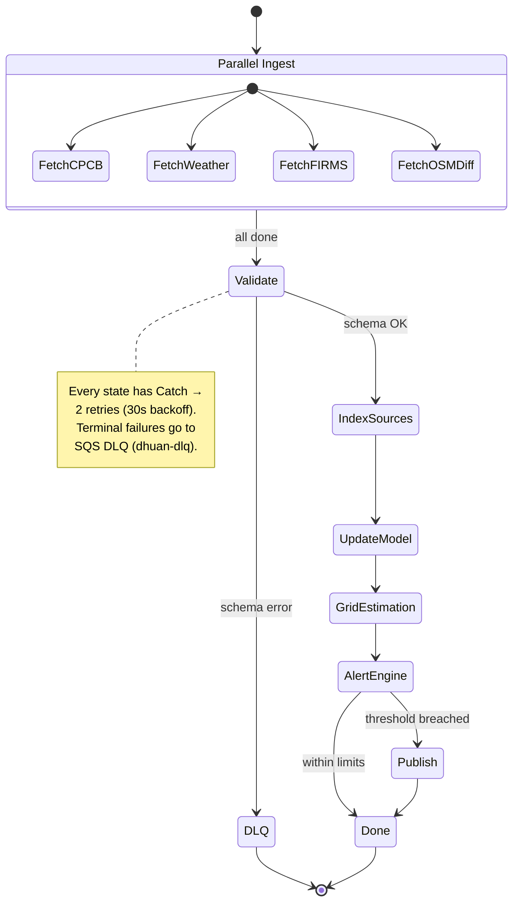
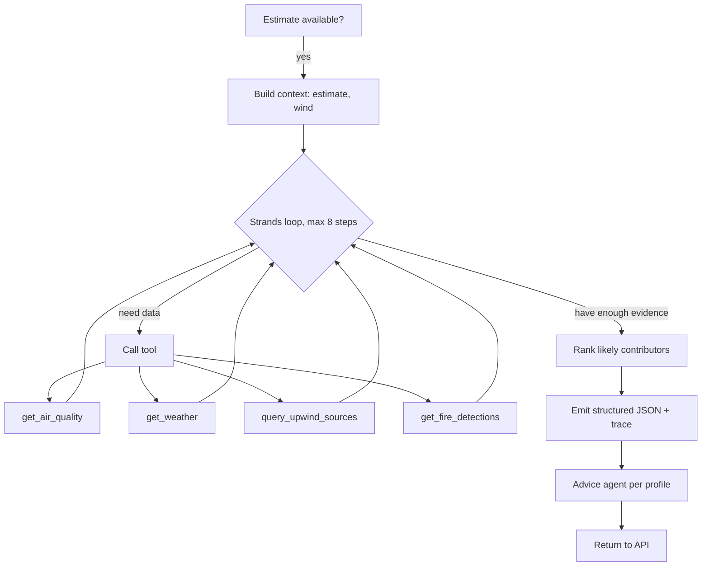

# Architecture — Dhuan Detective

This document describes the system that powers street-level air quality attribution for Delhi. It uses the [C4 model](https://c4model.com) plus sequence and state-machine diagrams.

## 1. System context

## 2. Container view

## 3. Request lifecycle — "why is my air bad?"

## 4. Hourly pipeline (Step Functions state machine)

## 5. Agent reasoning loop

## 6. Design decisions & boundaries
- **Pure geo math** lives in `backend/app/utils/geo.py` (haversine, bearing, upwind cone). No copies elsewhere.
- **One Lambda, one concern.** Ingestion, API, and inference are separate functions so the pipeline never imports FastAPI and API handlers never run training jobs.
- **Agent isolation.** Attribution logic is in `backend/app/agents/attribution_agent.py`; unit tests mock the tool/LLM boundary — zero external calls in CI.
- **Generated API types.** `frontend/src/lib/types.ts` is produced from Pydantic via `openapi-typescript`. Never hand-edit.
- **Time/scale:** Delhi ~1,500 km². A 1 km decision grid ≈ 1,500 cells; grid estimation is fanned out across Lambda and cached in DynamoDB.
- **Regional note:** OpenSearch + SageMaker are deployed in `ap-south-1`; Bedrock/Strands (if used for advice) in `us-east-1`, the closest region hosting the model.
