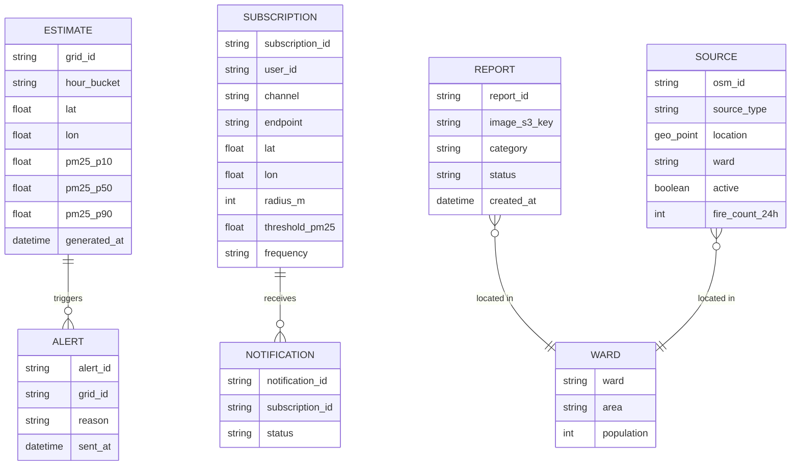
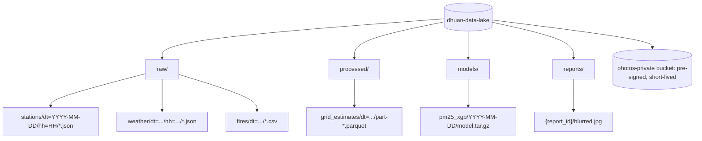

# Data Model — Dhuan Detective

## 1. Entity overview



## 2. DynamoDB tables

| Table | PK | SK | GSI | TTL | Purpose |
|-------|----|----|-----|-----|---------|
| `Estimates` | `grid_id#YYYYMMDDHH` | `lat#lon` | — | 2 h | Hourly grid PM2.5 with quantiles |
| `Subscriptions` | `subscription_id` | — | `status-index` (for alert engine scans) | — | Alert preferences |
| `Reports` | `report_id` | — | `ward-status-index` | — | Citizen photo reports |
| `AgentTraces` | `trace_id` | `timestamp` | `location-index` | 30 d | Real Strands traces |

Example Estimates item:
```json
{
  "grid_id": "5030#28.63#77.21",
  "hh": "2026-10-07T18",
  "lat": 28.6315,
  "lon": 77.2167,
  "pm25_p10": 171.2,
  "pm25_p50": 198.6,
  "pm25_p90": 231.4,
  "driver_features": { "nearest_station_km": 2.4, "wind_speed": 8.1 },
  "generated_at": "2026-10-07T18:05:00Z"
}
```

Example AgentTrace item:
```json
{
  "trace_id": "trc_01H",
  "timestamp": "2026-10-07T18:05:12Z",
  "location": { "lat": 28.6315, "lon": 77.2167 },
  "steps": [ { "tool": "get_weather", "input": {}, "output": "8 km/h NW" } ],
  "reasoning_summary": "Wind from NW; landfill + construction within 3 km upwind.",
  "final_output": { "likely_contributors": [] }
}
```

## 3. OpenSearch index `pollution_sources`

```json
{
  "mappings": {
    "properties": {
      "location":       { "type": "geo_point" },
      "source_type":    { "type": "keyword" },
      "name":           { "type": "text", "fields": { "keyword": { "type": "keyword" } } },
      "ward":           { "type": "keyword" },
      "active":         { "type": "boolean" },
      "fire_count_24h": { "type": "integer" },
      "osm_id":         { "type": "keyword" },
      "last_updated":   { "type": "date" }
    }
  }
}
```

Upwind-cone query (agent tool `query_upwind_sources`):
```json
{
  "query": {
    "bool": {
      "filter": [
        { "term": { "active": true } },
        { "geo_distance": { "distance": "5km", "location": { "lat": 28.6315, "lon": 77.2167 } } }
      ]
    }
  }
}
```
Sources are then filtered in-process by bearing within ±60° of the reverse-wind vector (see `backend/app/utils/geo.py`).

Index `agent_traces` stores serialized traces for analytics and for the UI's "How the Detective found this" panel.

## 4. S3 data lake layout



## 5. PostGIS staging (source geometry)

A PostGIS table stages raw OSM geometry before bulk-loading to OpenSearch. It is not a runtime dependency.

| Table | Geometry | Notes |
|-------|----------|-------|
| `stg_sources` | `geometry(Point, 4326)` | Deduplicated by `osm_id` |
| `stg_wards` | `geometry(Polygon, 4326)` | Ward boundaries for choropleth |
