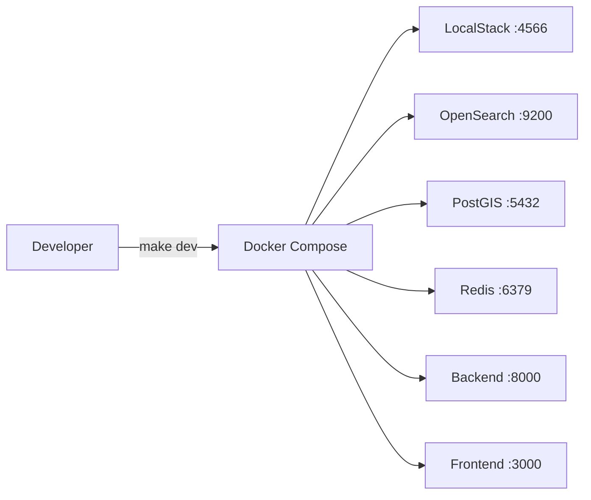
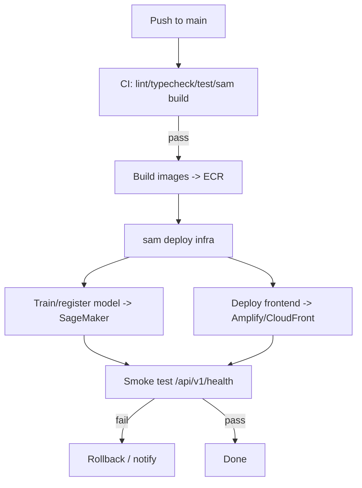

# Deployment — Dhuan Detective

Two targets: **local** (Docker Compose + LocalStack, zero AWS credentials) and **AWS** (`sam deploy`).

## 1. Local

```bash
cp .env.example .env
make dev            # docker compose up
make test           # pytest + frontend unit
```

Services: frontend `:3000`, API `:8000` (`/docs` for OpenAPI), OpenSearch `:9200`, LocalStack `:4566`, PostGIS `:5432`, Redis `:6379`. The `opensearch-seed` container loads a starter set of real Delhi sources; the `pipeline-worker` runs ingestion on a 60 s loop.



## 2. AWS



Steps (requires AWS credentials):
```bash
make cd          # sam build --use-container && sam deploy
# or explicitly:
cd backend && sam build --use-container
sam deploy --config-file ../infra/samconfig.toml
```

Provisioned resources (see `infra/template.yaml`): API Gateway (REST + WS), Lambda functions, DynamoDB tables, OpenSearch domain, S3 buckets (data + private photos), SNS topic, SQS DLQ, EventBridge rule (hourly), Step Functions state machine, SageMaker endpoint, Amazon Location map + place index, Cognito user pool.

## 3. CI/CD (GitHub Actions)
| Workflow | Trigger | Gates |
|----------|---------|-------|
| `ci.yml` | PR / push `develop` | backend lint+test, frontend lint+typecheck+unit, `sam build` |
| `cd.yml` | merge to `main` | ECR build, `sam deploy`, model register, smoke test, rollback on failure |
| `nightly-data.yml` | cron `0 * * * *` | manually invokes the Step Functions pipeline |

## 4. Configuration & secrets
- All secrets live in `.env` (local) or SSM/Secrets Manager (production). Only `.env.example` is committed.
- Lambda environment variables are set from `.env` template at build; no secret is hardcoded.

## 5. Environments
- `local` — Docker/LocalStack defaults.
- `staging` — deployed from `develop`, separate stack name.
- `production` — deployed from `main`, `ap-south-1` (OpenSearch/SageMaker/Location), `us-east-1` (Bedrock, if used for advice).

## 6. Rollback
If the smoke test fails post-deploy, the CD workflow redeploys the previous stable CloudFormation stack version and posts the failure to the team channel. Runbook details in [`RUNBOOK.md`](RUNBOOK.md).
