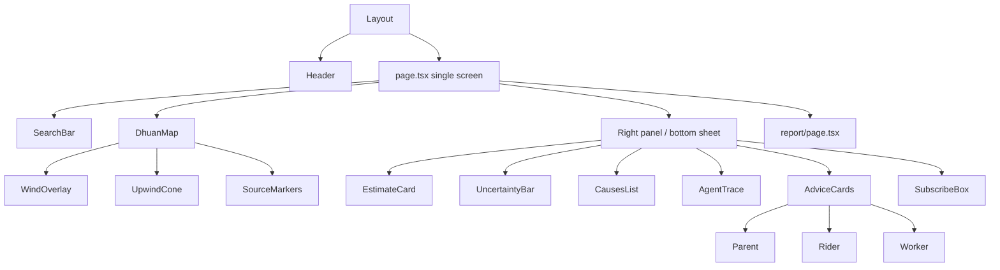

# Frontend — Dhuan Detective

Next.js 14 (App Router), TypeScript, Tailwind CSS, shadcn/ui, MapLibre GL JS. Single-screen, mobile-first, English + Hindi (`next-intl`).

## Component tree

## Responsive rules
| Breakpoint | Layout |
|-----------|--------|
| < 768 px (mobile) | Map full-screen; info is a swipeable bottom sheet; search floats on top; agent trace opens as a full-screen modal |
| ≥ 768 px (desktop) | Map 60% left; fixed right panel 40%; search centered as overlay |

- Test all components at **320 px**. No horizontal scroll; touch targets ≥ 44×44 px.
- Numbers use `tabular-nums` and large type (readable on phones).
- Skeleton screens for loading (not spinners). Friendly error states with a Retry action.

## State & data
- `useEstimate` (SWR) fetches `/api/v1/estimate` and revalidates on map idle.
- `useAmazonLocation` powers the search bar (geocoding) and map tiles.
- `useWebSocket` subscribes to `weather.update` and `fire.detected` for the current map area.
- API types are generated (`src/lib/types.ts`) from Pydantic via `openapi-typescript` — do not hand-edit.

## Honesty in UI
- Every estimate shows an uncertainty range.
- Causes are labeled "Likely contributor" with a confidence badge; never "confirmed".
- The "How the Detective found this" panel renders the real Strands trace.
- Colors carry meaning only (AQI bands); decoration uses neutral slate.

## Testing
- Unit (vitest): `EstimateCard`, `UncertaintyBar`, `AgentTrace`, `AdviceCards`, `DhuanMap` marker rendering, `SearchBar` debounce.
- E2E (Cypress): `home` (search → estimate → advice), `responsive` (`iphone-x` → bottom sheet; `macbook-16` → side panel), `a11y` (axe-core aria/contrast).
