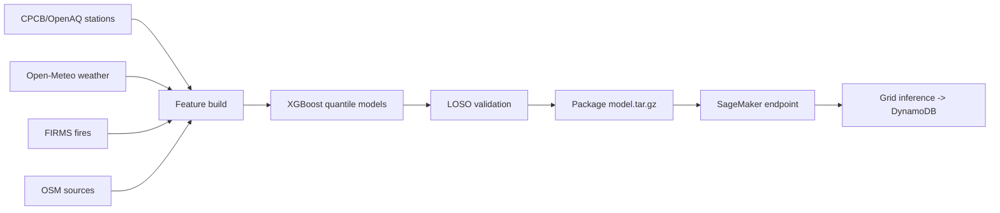
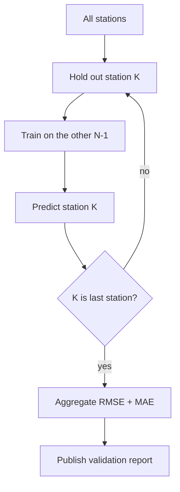

# ML Model — Street-Level PM2.5 Estimation

## 1. Approach
Gradient-boosted trees (XGBoost) estimate PM2.5 at any Delhi coordinate from station, weather, fire, and land-use features. Uncertainty comes from **quantile regression** at `p10/p50/p90`.

## 2. Pipeline



## 3. Features (per lat, lon, hour)
| Feature | Source |
|---------|--------|
| Distance to nearest station | Computed (haversine, via `utils/geo.py`) |
| IDW-PM2.5 of 3 nearest stations | Computed |
| Boundary-layer height | Open-Meteo |
| Wind u/v components | Open-Meteo |
| Precipitation, temperature | Open-Meteo |
| Distance to nearest landfill | OpenSearch |
| Distance to nearest major road / junction | OpenSearch |
| Distance to nearest industrial zone | OpenSearch |
| FIRMS fire count within 30 km | S3 / FIRMS |
| Aerosol Optical Depth (optional) | Sentinel-5P / MODIS |
| Hour / day-of-week / month (cyclical) | Derived |

Missing OSM distances default to a max-distance constant (50 km) with an "absent" indicator feature.

## 4. Validation — Leave-One-Station-Out (LOSO)
Train on N−1 stations, predict the held-out station, repeat across all stations, then aggregate. This error number is published openly in the demo and here.



Report shape:
```json
{ "method": "LOSO", "n_stations": 38, "rmse": 0.0, "mae": 0.0, "quantiles": [0.1, 0.5, 0.9] }
```
(Metrics are populated from a real run; never fabricated.)

## 5. Serving
- **Local:** `ml/src/serve.py` loads the artifact and serves from a FastAPI route.
- **Production:** packaged to `s3://dhuan-data-lake/models/pm25_xgb/<date>/model.tar.gz` and hosted on a SageMaker serverless endpoint. The `GridInference` Lambda fans out over the 1 km grid and writes to DynamoDB `Estimates`.

## 6. Training ops
- Step Functions (`UpdateModel`) retrains hourly with a **shadow-compare gate**: the new model replaces the endpoint only if validation error is not worse than the incumbent.
- Artifacts and metrics are versioned by date in S3.

## 7. Honest caveats (must appear in demo/docs)
- The model **estimates**; it does not measure. Away from stations, error grows — hence the uncertainty range is always shown.
- Coarse inputs and station sparsity dominate the error floor. State this plainly rather than overclaiming.
