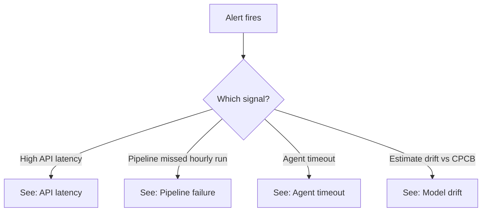
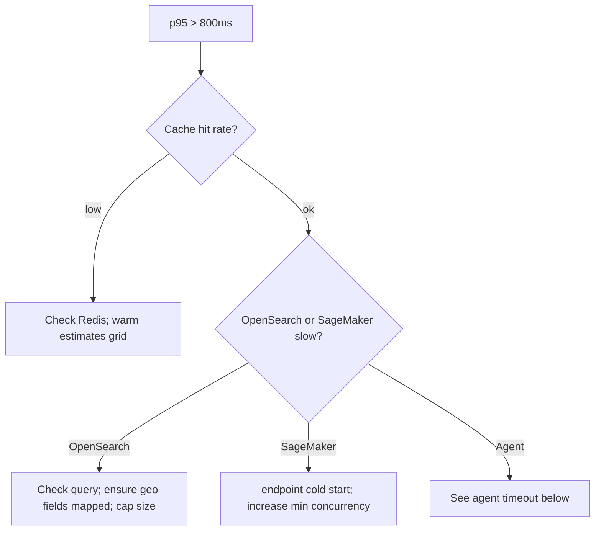

# Runbook — Dhuan Detective

Decision trees for common operational failures.

## Alert routing

## 1. High API latency (`GET /estimate` p95 > 800 ms)

## 2. Pipeline failure (no new `Estimates` in > 90 min)
1. Step Functions console → find failed execution → inspect the state and error.
2. Check the SQS DLQ (`dhuan-dlq`) count.
3. Common causes: external feed timeout (CPCB/FIRMS). Circuit breaker should have used the fallback; if not, verify `EXTERNAL_API_TIMEOUT_SECONDS` and breaker threshold.
4. Re-run: `make pipeline` (local) or start-execution (prod).

## 3. Agent timeout / no attribution
- `STRANDS_MAX_STEPS` exceeded or a tool errored. The API should have returned `attribution_available: false` (estimate-only) — confirm, rather than letting the whole request 500.
- If the agent boundary fails, verify tool fixtures in CI use mocks; never call live LLM in tests.

## 4. Estimate drift vs CPCB (bias > 30% sustained)
- Re-run LOSO validation (`ml/src/evaluate.py`). If error regressed, the shadow-compare gate should block promotion; if bypassed, roll back to the last stable model artifact in S3 and redeploy the SageMaker endpoint.

## Severity → response
| Severity | Example | Action |
|----------|---------|--------|
| Sev-2 | Pipeline down, API degraded | Page on-call; DLQ replay |
| Sev-3 | Single feed down (breaker active) | Slack notify; monitor fallback age |
| Sev-4 | Cosmetic / drift watch | Ticket |
